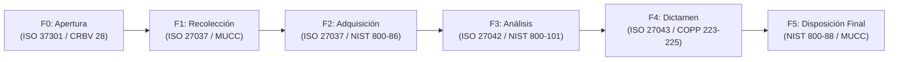

<div align="center">

# 🛡️ Forensic Chief Compliance Officer (FCCO) — SHA256.US

### *Sistema Canónico de Cadena de Custodia, Peritaje Informático y Compliance Legal*

[](https://astro.build/)
[](https://designsystem.digital.gov/)
[](https://php.net/)
[](https://cpanel.net/)
[](https://www.typescriptlang.org/)
[](LICENSE)

---

**Forensic Chief Compliance Officer (FCCO — SHA256.US)** es una plataforma web **Cyber-Legal** de alto nivel diseñada para peritos informáticos, auditores y Compliance Officers. Permite la administración rigurosa de evidencias digitales, el seguimiento estricto de protocolos normativos y la generación de documentos con validez legal bajo estándares **ISO/IEC 27037**, **ISO/IEC 27042**, **NIST SP 800-86**, **MUCC-2017** y **COPP Art. 187**.

</div>

---

## ⚡ Capacidades Principales del Sistema

<table width="100%">
  <tr>
    <td width="50%" valign="top">
      <h3>🏛️ 1. Interfaz Nativa USWDS (@uswds/uswds)</h3>
      <p>Diseño institucional de laboratorio forense bajo los estándares del <b>Defense Cyber Crime Center (DC3)</b>. Utiliza exclusivamente componentes federales: <code>.usa-banner</code>, <code>.usa-header</code>, <code>.usa-sidenav</code>, <code>.usa-step-indicator</code>, <code>.usa-summary-box</code>, <code>.usa-alert</code> y <code>.usa-table</code>.</p>
    </td>
    <td width="50%" valign="top">
      <h3>🔒 2. Ciclo Pericial ISO en 6 Fases (F0 - F5)</h3>
      <p>Control de avance determinista: ninguna etapa puede cerrarse sin cumplir los requisitos técnicos obligatorios (fijación, aislamiento Faraday, bloqueadores de escritura y verificación de hash génesis SHA-256).</p>
    </td>
  </tr>
  <tr>
    <td width="50%" valign="top">
      <h3>📜 3. Catálogo de 13 Planillas Oficiales en Folio</h3>
      <p>Preservación matemática y dimensional al 100% en formato <b>Folio / Oficio (216mm × 330mm)</b> con márgenes reglamentarios (Izquierda 30mm), membrete institucional, dactiloscopía bilateral (pulgar izquierdo y derecho) y aislamiento total de estilos mediante <code>.folio-forense-aislado</code>.</p>
    </td>
    <td width="50%" valign="top">
      <h3>⛓️ 4. Auditoría Inmutable (Hash Chain SHA-256)</h3>
      <p>Cada acción en el expediente queda sellada en una cadena inmutable donde cada bloque contiene el hash SHA-256 del bloque inmediatamente anterior, respaldado por triggers anti-tamper en MySQL.</p>
    </td>
  </tr>
  <tr>
    <td width="50%" valign="top">
      <h3>📚 5. Base de Conocimiento Normativo RAG</h3>
      <p>Compendio interactivo de <b>77 directrices y normativas</b> (ISO/IEC 27037, 27042, 27043, 27001, 37301, NIST SP 800-86, NIST SP 800-88, MUCC-2017, COPP, CRBV 28/60, RFC 3227).</p>
    </td>
    <td width="50%" valign="top">
      <h3>⚡ 6. Arquitectura Estática + cPanel (Apache + PHP)</h3>
      <p>Compilación 100% estática en <b>Astro (<code>output: 'static'</code>)</b> con respaldo offline inmediato en <b>IndexedDB</b> y API REST ligera en <b>PHP puro con PDO</b> lista para desplegarse en cualquier hosting cPanel compartido o dedicado.</p>
    </td>
  </tr>
</table>

---

## 🔬 Ciclo Pericial Canónico ISO (6 Fases F0 a F5)



1. **Fase F0 (Apertura y Legitimación):** Consentimiento informado, fijación de alcance y legitimación pericial.
2. **Fase F1 (Identificación y Recolección):** Fijación fotográfica 360°, aislamiento electromagnético (bolsa Faraday / modo avión), embalaje numerado y apertura formal de la PRCC.
3. **Fase F2 (Adquisición y Preservación):** Desprecintado en laboratorio, uso de bloqueadores de escritura certificados, clonación bit-a-bit (E01/DD) y cálculo de hash génesis SHA-256.
4. **Fase F3 (Análisis e Interpretación):** Análisis científico sobre copia de trabajo con herramientas validadas (ALEAPP, Kali, IPED, Sonic Visualiser) y metodología reproducible.
5. **Fase F4 (Informe Pericial y Dictamen):** Redacción motivada de conclusiones con cita de hashes SHA-256 y firma bilateral de dos peritos habilitados.
6. **Fase F5 (Entrega, Disposición y Sanitización):** Entrega formal de evidencias y sanitización certificada (Zeroization / Crypto-Erase) de los discos de trabajo del laboratorio.

---

## 📜 Catálogo Canónico de 13 Planillas Oficiales en Folio (216mm × 330mm)

| # | Planilla Oficial | Fase ISO | Marco Normativo | Ruta de Impresión |
|:--|:-----------------|:---------|:----------------|:------------------|
| 1 | **Acta de Consentimiento Informado** | F0 | CRBV Arts. 28 y 60 · Hábeas Data | `/planillas/acta-consentimiento` |
| 2 | **Acta de Entrevista Forense al Consignante** | F0 | ISO/IEC 27043 §8.3 · MUCC-2017 | `/planillas/acta-entrevista` |
| 3 | **Acta de Obtención y Preservación Inicial** | F1 | MUCC-2017 §4 · COPP Art. 187 | `/planillas/acta-obtencion` |
| 4 | **Planilla de Registro de Cadena de Custodia (PRCC)** | F1/F2 | COPP Art. 187 · Gaceta N° 41.247 | `/planillas/planilla-prcc` |
| 5 | **Acta de Desprecintado y Apertura en Laboratorio** | F2 | MUCC-2017 Fase Laboratorio · ISO 27037 | `/planillas/acta-desprecintado` |
| 6 | **Planilla de Análisis Forense de Audio (Sonic Visualiser)** | F3 | SWGDE · FRE 702 · ISO/IEC 27042 | `/planillas/planilla-audio-sonic` |
| 7 | **Planilla de Evaluación de Calidad UX y Servicio** | F3 | ISO 37301 §9.1 · ISO 9001 | `/planillas/planilla-evaluacion-ux` |
| 8 | **Dictamen Pericial Oficial de Informática Forense** | F4 | COPP Arts. 223–225 · ISO/IEC 27043 | `/planillas/acta-dictamen` |
| 9 | **Dictamen Especializado de Autenticidad de Imágenes** | F4 | ISO/IEC 27042 · Estándar Daubert | `/planillas/dictamen-imagenes` |
| 10 | **Dictamen Especializado de Autenticidad de Audios** | F4 | ISO/IEC 27042 · SWGDE Guidelines | `/planillas/dictamen-audios` |
| 11 | **Acta de Entrega de Resultados y Evidencias** | F5 | MUCC-2017 Disposición Final · COPP 187 | `/planillas/acta-entrega-resultados` |
| 12 | **Acta de Sanitización de Medios del Laboratorio** | F5 | NIST SP 800-88 Rev. 1 · ISO/IEC 27001 | `/planillas/acta-sanitizacion` |
| 13 | **Acta de Auditoría y Línea de Tiempo Inmutable** | F5 | ISO/IEC 27001 A.8.15 · SHA-256 Chain | `/planillas/acta-auditoria-timeline` |

---

## 🚀 Guía de Despliegue en cPanel (Paso a Paso)

### 1. Compilación Estática
En su máquina local o entorno de CI:
```bash
npm install
npm run build
```
Esto compila el tema Sass nativo de USWDS y genera el directorio `dist/` con 22 páginas HTML optimizadas, la carpeta `dist/api/` y el archivo `.htaccess`.

### 2. Base de Datos MySQL / MariaDB
1. Ingrese a su panel de control **cPanel**.
2. Abra **Bases de datos MySQL** y cree una nueva base de datos (ej. `tuusuario_sha256us`).
3. Cree un usuario MySQL con contraseña segura y asígnele **TODOS LOS PRIVILEGIOS** sobre la base creada.
4. Abra **phpMyAdmin**, seleccione la base de datos recién creada e importe el archivo `database.sql` ubicado en la raíz del proyecto.

### 3. Configurar Credenciales de Base de Datos
Edite el archivo `public/api/config.php` (o `dist/api/config.php` antes de subirlo):
```php
define('DB_HOST', 'localhost');
define('DB_NAME', 'tuusuario_sha256us');
define('DB_USER', 'tuusuario_dbuser');
define('DB_PASS', 'TuPasswordSeguro123!');
define('DB_CHARSET', 'utf8mb4');
```

### 4. Subir Archivos a `public_html`
1. Abra el **Administrador de Archivos** de cPanel o conéctese vía **SFTP**.
2. Navegue hasta la carpeta raíz web (`public_html/` o el subdirectorio de su subdominio).
3. Suba todo el contenido generado dentro de `dist/`:
   ```
   public_html/
   ├── .htaccess             <- Reglas Apache de URL limpias y seguridad
   ├── api/                  <- API REST en PHP puro con PDO
   │   ├── config.php
   │   ├── casos.php
   │   ├── avanzar-etapa.php
   │   ├── auditoria.php
   │   ├── auth.php
   │   └── lib/
   ├── assets/               <- USWDS CSS, JS, Fuentes e Iconos
   ├── planillas/            <- 13 Planillas HTML en Folio
   ├── dashboard.html
   ├── casos.html
   ├── flujo.html
   ├── custodia.html
   ├── normativa.html
   ├── auditoria.html
   ├── exportar.html
   └── index.html            <- Página de acceso al sistema
   ```
4. Verifique que `.htaccess` esté presente en la raíz de `public_html`.

### 5. Acceso Inicial
- Ingrese en su navegador a `https://tu-dominio.com/`.
- Credenciales iniciales de administrador:
  - **Correo:** `julljoll@gmail.com`
  - **Contraseña:** `AdminForensic2026!`

---

## 🧪 Pruebas Automatizadas y Calidad

El proyecto cuenta con una suite completa de pruebas unitarias y de integración en Vitest:
```bash
npm test
```

Suite validada:
- `tests/unit/build/distVerification.test.ts`: Valida que `dist/` contenga todas las 22 páginas HTML, `.htaccess`, `database.sql` y controladores PHP.
- `tests/unit/planillas/paridad.test.ts`: Valida el 100% de paridad y presencia de campos legales en las 13 planillas Folio.
- `tests/unit/crypto/canonical.test.ts`: Valida el algoritmo de serialización canónica RFC 8785 y paridad con vectores de prueba SHA-256.
- `tests/unit/domain/gating.test.ts`: Valida las reglas de bloqueo estricto del ciclo ISO.
- `tests/unit/crypto/hashChain.test.ts`: Valida la verificación de integridad criptográfica de la cadena.

---

## 🏛️ Gobernanza y Normativa Legal

- **Estándares Forenses:** ISO/IEC 27037:2012 · ISO/IEC 27042:2015 · ISO/IEC 27043:2015 · ISO 37301 · ISO/IEC 27001.
- **Estándares NIST:** NIST SP 800-86 · NIST SP 800-88 Rev. 1 · NIST SP 800-101 Rev. 1.
- **Marco Legal Nacional:** MUCC-2017 (Gaceta Oficial N° 41.247) · COPP Arts. 187, 223–225 · CRBV Arts. 28 y 60 · LEDI (Gaceta N° 37.313) · LMDF (Gaceta N° 37.076).
- **Manual Canónico de Desarrollo:** Consultar [.agents/AGENTS.md](file:///.agents/AGENTS.md).
